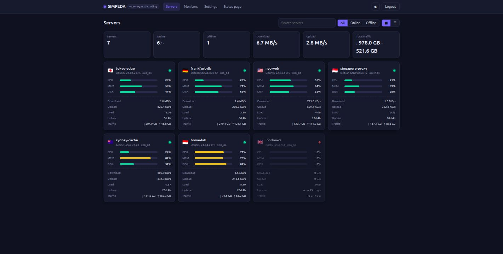
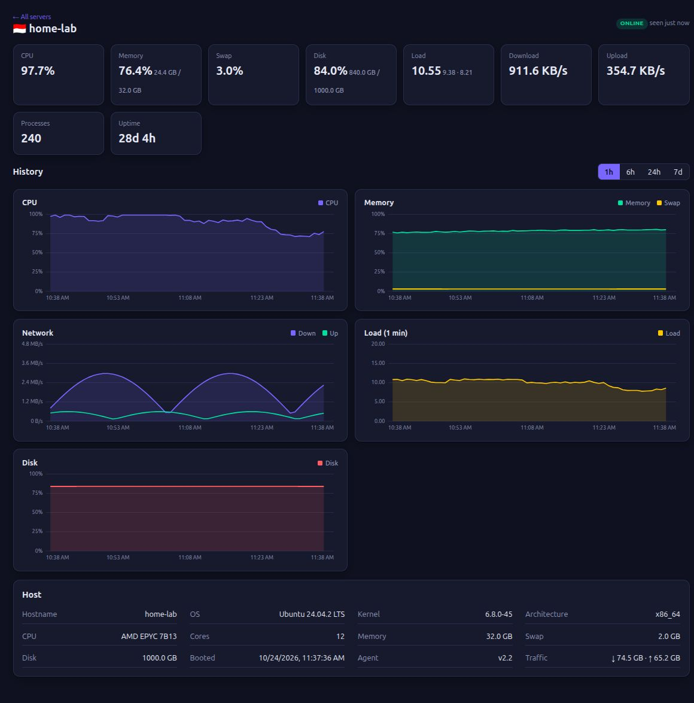
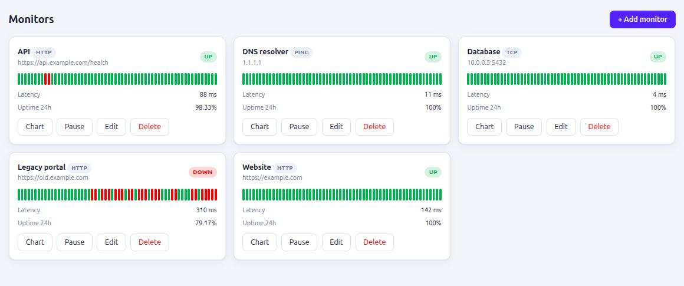
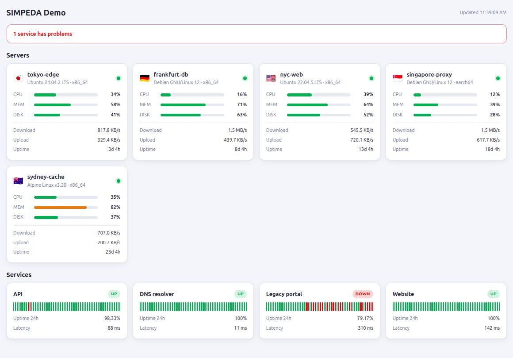
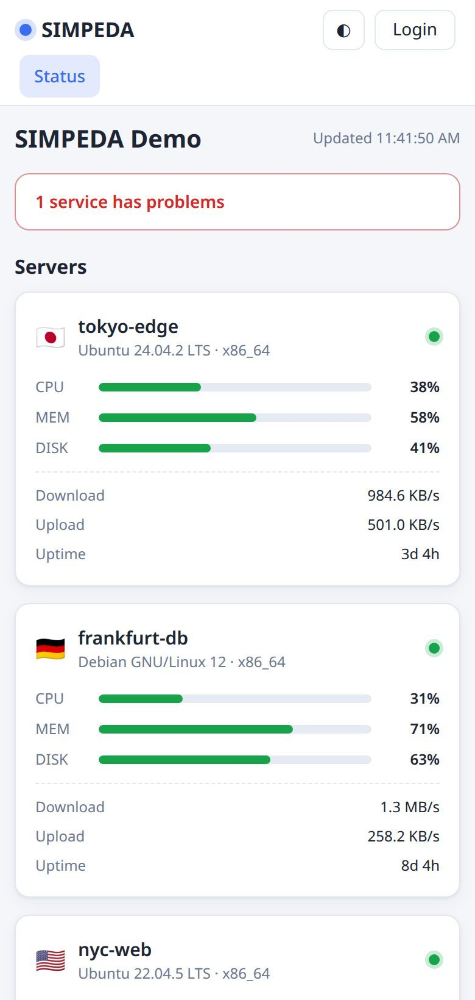

<p align="center">
  
</p>

<h1 align="center">SIMPEDA</h1>

<p align="center">
  Self-hosted server monitoring in one PHP file.<br>
  Watch many servers, see history, check services, get alerts.
</p>

Inspired by [Nezha](https://github.com/nezhahq/nezha). Data lives in [PocketBase](https://pocketbase.io).



## Features

- **Dashboard**: CPU, memory, disk, network speed, load, uptime and traffic for every server. Cards or table, search, online/offline filter.
- **History**: charts for CPU, memory, network, load and disk. Ranges: 1h, 6h, 24h, 7d.
- **Agents**: any Linux box with PHP reports in with one command. One token per server.
- **Monitors**: HTTP(S), TCP and ping checks with latency and 24h uptime.
- **Alerts**: server offline, high CPU/memory/disk, failing monitors. Sent to Discord, Telegram or a webhook, with recovery notices.
- **Status page**: optional public page. Shows only what you mark public.
- **Light and dark theme**, works on phones.

## Screenshots

| Server detail | Monitors |
| --- | --- |
|  |  |

| Public status page | On a phone |
| --- | --- |
|  |  |

## Quick start

You need Linux, PHP 8.2+ with `curl`, and `unzip`.

```bash
php build.php build            # or download index.php from a release
cd build
php index.php install          # asks for an email and a hidden password
php -S 0.0.0.0:8000 index.php  # dev server (use PHP-FPM in production)
php index.php worker           # in a second terminal: monitors and alerts
```

Open `http://localhost:8000` and sign in with the account you just created.

`install` downloads PocketBase (checksum verified), creates your admin account, the database and a service account. There is no web installer, so nobody can claim a fresh instance from the browser.

## Add a server

1. **Settings → Add server**, enter a name.
2. Copy the commands shown (the token appears once). Run them on that server:

```bash
curl -fsSL https://dash.example.com/download/agent -o simpeda.php
php simpeda.php agent --url=https://dash.example.com --token=spk_...
```

Add `--once` to test a single report. The dialog also gives a systemd unit to keep the agent running. To watch the dashboard host itself, add it like any other server.

## Usage

### Pages

| Page | What it does |
| --- | --- |
| `/dashboard` | All servers, live. |
| `/server?id=…` | One server: live numbers, charts, host info. |
| `/monitors` | Add, pause, edit and chart monitors. |
| `/settings` | Servers and tokens, public page, alert limits, notifications, recent alerts. |
| `/status` | Public page (off until you enable it). |

### Commands

| Command | Purpose |
| --- | --- |
| `php index.php install` | Create the admin, set up PocketBase. |
| `php index.php migrate` | Apply schema changes after an upgrade. |
| `php index.php worker` | Run monitors, send alerts, delete old data. Keep it running. |
| `php index.php agent --url=… --token=…` | Report this machine to a dashboard. `--interval=5`, `--once`. |

### Alerts

Set limits in **Settings → Alert thresholds** and a channel in **Notifications** (Discord webhook, Telegram bot, or a generic JSON webhook). Use **Send test** to check it. Alerts are sent by the worker, so it must be running. Each alert is sent once and followed by a recovery message.

### Public status page

Enable it in Settings, then mark servers and monitors as **public**. The page shows name, status, CPU, memory, disk, network and uptime. It never shows IPs, hostnames, processes or logs.

### API

JSON under `/api/*`. Sign in first and send `X-CSRF-Token` (from `GET /api/session`) on writes. Agents use `POST /api/agent/report` with their token. `GET /api/public` is open when the status page is on.

## Configuration

Set as environment variables.

| Variable | Default | Purpose |
| --- | --- | --- |
| `SIMPEDA_PB_DIR` | `pocketbase` | Folder with PocketBase, its data and service credentials |
| `SIMPEDA_RETENTION_DAYS` | `7` | Days of history kept (1 to 90) |
| `SIMPEDA_POCKETBASE_URL` | `http://127.0.0.1:8090` | PocketBase address |
| `SIMPEDA_VERIFY_INTERVAL` | `300` | Seconds a login is trusted before PocketBase re-checks it |
| `SIMPEDA_AGENT_TOKEN` | – | Agent token, instead of `--token` |
| `SIMPEDA_VERSION` | `git describe` | Version shown in the UI (build time) |

## Production notes

- Serve `index.php` with PHP-FPM behind nginx or Apache, over HTTPS. Route every request to `index.php`.
- **Block the `pocketbase/` folder** (it holds the database and credentials) or move it with `SIMPEDA_PB_DIR`:

  ```nginx
  location ^~ /pocketbase/ { deny all; }
  location / { try_files $uri /index.php$is_args$args; }
  ```

- Run the worker as a service:

  ```ini
  # /etc/systemd/system/simpeda-worker.service
  [Service]
  WorkingDirectory=/var/www/simpeda
  ExecStart=/usr/bin/php index.php worker
  Restart=always
  [Install]
  WantedBy=multi-user.target
  ```

- After upgrading, run `php index.php migrate` and restart the worker.
- PocketBase's `superuser create` takes the password as an argument, so it is visible in the process list for a few seconds during install.

## Security

Admin login is checked against PocketBase. Forms and API writes need a CSRF token. A strict Content-Security-Policy is sent. Agent tokens are stored as SHA-256 hashes. Use HTTPS so agent tokens are never sent in clear text.

## Development

```bash
composer install     # PHPStan only
composer check       # lint, PHPStan, build, smoke tests
composer test:e2e    # real PocketBase, needs network, ports 8000/8090/8099, ~2 min
php build.php serve 8000   # build, watch, serve
```

`src/` is concatenated into `build/index.php`. `src/api.php` runs first, so other files must only declare functions and classes.

- `tests/smoke.sh`: quick auth checks against a stub PocketBase.
- `tests/e2e.sh`: install, agents, history, monitors, worker, alerts, status page, CSP.

CI (`.github/workflows/ci.yml`) runs lint on PHP 8.2 to 8.5, PHPStan, build, smoke and e2e. A `v*` tag builds a draft release with a SHA-256 checksum and a provenance attestation (`gh attestation verify index.php --repo Zxce3/simpeda`). Actions are pinned by SHA and updated by Dependabot.

## Layout

```
src/api.php        routing, CLI, PocketBase install
src/lib/           agent, worker, JSON API, store, schema, auth, UI css/js
src/components/    page layout
src/pages/         pages
build.php          build script
tests/             smoke and e2e tests
assets/            README screenshots
```

## License

MIT. See [LICENSE](LICENSE).
